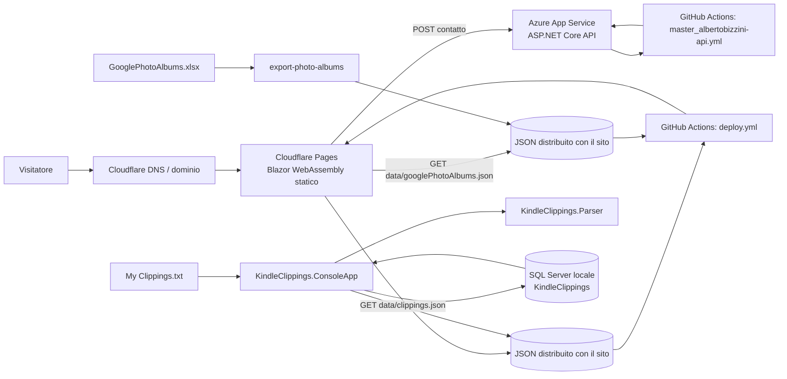

# Aggiornamento dei Clippings e degli album fotografici

Questa guida descrive il flusso attuale ricostruito dai progetti e dai workflow GitHub Actions del repository.

## Architettura attuale



Il dominio e il DNS sono gestiti in Cloudflare; il workflow pubblica il frontend sul progetto Cloudflare Pages `albertobizzini-com`. Il frontend carica i due JSON da `wwwroot/data`. L'API `albertobizzini-api` su Azure gestisce il modulo contatti; in base al codice esaminato, non fornisce i Clippings né i dati degli album. La configurazione del client contiene l'URL Azure, ma i dati di pagina sono letti da file statici.

## Aggiornare i Clippings

1. Sostituire `KindleClippings.ConsoleApp/My Clippings.txt` con il file aggiornato esportato dal Kindle.
2. Aprire la soluzione nell'ambiente che dispone di SQL Server locale `localhost\SQLDEV` e del database `KindleClippings`.
3. Dalla cartella `KindleClippings.ConsoleApp`, eseguire:

   ```powershell
   dotnet run --project .\KindleClippings.ConsoleApp.csproj -- import
   ```

   Il comando predefinito legge `My Clippings.txt`, analizza il testo con `KindleClippings.Parser`, importa/aggiorna i record SQL e genera `AlbertoBizzini.Web/wwwroot/data/clippings.json`.

4. Controllare il riepilogo degli inserimenti/aggiornamenti, il numero esportato e il JSON risultante. Verificare in particolare che non sia vuoto e che i nuovi elementi abbiano ID univoci.
5. Committare il JSON aggiornato (e il file sorgente solo se si desidera conservarlo nel repository secondo le proprie regole sui dati personali) e fare push sul branch `master` per la pubblicazione di produzione.

La pipeline `.github/workflows/deploy.yml` si attiva sui cambiamenti sotto `AlbertoBizzini.Web/**` e distribuisce `release/wwwroot` su Cloudflare Pages. Il deploy API Azure non è necessario per un aggiornamento dati. Anche `staging` attiva la pipeline Pages usando il nome branch, ma la disponibilità di un ambiente/alias Pages di staging dipende dalla configurazione del progetto Cloudflare.

## Aggiornare gli album fotografici

1. Aggiornare il workbook `KindleClippings.ConsoleApp/GooglePhotoAlbums.xlsx` (nonostante la cartella, è il workbook usato dall'esportatore). Usare i fogli e le intestazioni previsti dal codice:
   - `Albums`: `AlbumId`, `Data da`, `Data a`, `Titolo`, `URL pubblico`, `URL album`.
   - `AlbumLocations`: `AlbumId`, `Order`, `Continente`, `Luogo (nazione)`, `Luogo (nazione) - English`, `Luogo (città)`, `Luogo (città) - English`, `Luogo (Latitudine)`, `Luogo (Longitudine)`.
2. Per ogni album destinato al sito, impostare l'URL di condivisione in `URL pubblico`. L'esportatore scarta gli album che hanno `URL pubblico` vuoto. `URL album` è richiesto come colonna nel workbook ma non viene pubblicato nel JSON.
3. Associare le località tramite `AlbumId`, mantenere univoco `AlbumId` e l'ordine `Order` per album. Latitudine e longitudine devono essere entrambe presenti o entrambe vuote e nei rispettivi intervalli geografici.
4. Dalla cartella `KindleClippings.ConsoleApp`, eseguire:

   ```powershell
   dotnet run --project .\KindleClippings.ConsoleApp.csproj -- export-photo-albums
   ```

   Output predefinito: `AlbertoBizzini.Web/wwwroot/data/googlePhotoAlbums.json`. È possibile specificare `--input <file.xlsx>` e `--output <file.json>`.

5. Controllare conteggio e contenuto JSON, quindi committare il JSON aggiornato e fare push su `master`. La pipeline Pages pubblica il nuovo file insieme al frontend. Non è richiesto un deploy API.

## Flusso di rilascio e controlli

| Modifica | Azione | Workflow / destinazione |
|---|---|---|
| `wwwroot/data/clippings.json` | Import dal TXT via ConsoleApp, controllo, commit e push | `deploy.yml` → Cloudflare Pages |
| `wwwroot/data/googlePhotoAlbums.json` | Modifica workbook, export via ConsoleApp, controllo, commit e push | `deploy.yml` → Cloudflare Pages |
| Codice API / Services / Shared | Build e deploy API | `master_albertobizzini-api.yml` → Azure App Service |
| Codice Web / Shared / Parser | Build e deploy frontend | `deploy.yml` → Cloudflare Pages |

Dopo il deploy, aprire il sito e verificare una citazione aggiornata e la pagina `/photo-albums`. Se il browser continua a mostrare dati precedenti, forzare il refresh e controllare la risposta dei JSON dalla rete/browser; Cloudflare Pages distribuisce file statici e cache browser/CDN può influire sulla percezione dell'aggiornamento.

## Note operative e limiti attuali

- L'importatore Clippings usa una connection string SQL Server locale codificata nel sorgente (`localhost\\SQLDEV`, database `KindleClippings`). L'operazione di import richiede quindi quell'ambiente/database; non è un import eseguito da GitHub Actions né dall'API Azure.
- La pipeline frontend imposta .NET `10.0.x` e pubblica il sito Blazor WebAssembly; non importa il database e non esegue gli exporter. I file JSON devono essere generati e committati prima del push.
- Il workflow API Azure si attiva solo sul branch `master` quando cambiano API, Services, Shared o il workflow stesso. La configurazione include CORS per `https://albertobizzini.com`.
- Se in futuro si vuole aggiornare i dati senza commit/deploy del frontend, occorre spostare i dati dietro un endpoint API o uno storage dedicato. In tal caso andranno previsti persistenza, autenticazione per le operazioni di scrittura, CORS, backup e una strategia di cache/versionamento. Questo non è il comportamento implementato oggi.
